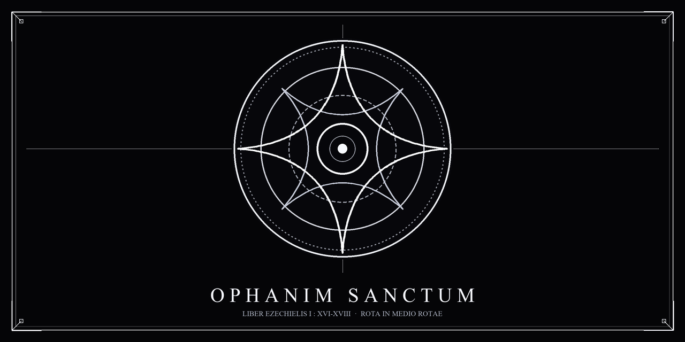
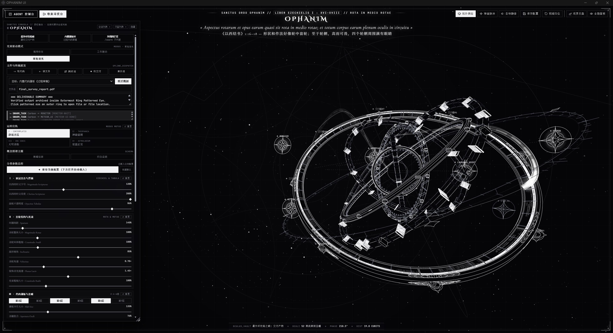

  

# קֹדֶשׁ הָאוֹפַנִּים‎ · OPHANIM SANCTUM

> ‎« וּמַרְאֵיהֶם וּמַעֲשֵׂיהֶם כַּאֲשֶׁר יִהְיֶה הָאוֹפַן בְּתוֹךְ הָאוֹפָן · וְגַבֵּיהֶן וְגֹבַהּ לָהֶם וְיִרְאָה לָהֶם וְגַבֹּתָם מְלֵאֹת עֵינַיִם סָבִיב לְאַרְבַּעְתָּן׃‎ »  
> 《以西结书》1:16–18 —— 形状和作法好像轮中套轮，高而可畏，四个轮辋周围满有眼睛。

**Ophanim Sanctum** 是一个纯黑白消隐建筑线框风格的 **3D 实时 AI 智能体全息观测圣殿与 Windows 互动动态桌面壁纸**。它将 AI Agent 的思考、文件读写、核心架构镌刻、`/swarm` 子智能体并发、Token 速率以及任务完工仪式，映射为一座实时运转的七重同心浑天圣轮。

## 实机运行画面预览 (Live Sanctuary Preview)

  

---

## 一键下载打包好的压缩包（免 Git，点击直接下载）

不用找深藏在侧边栏的入口，直接点击下方链接即可下载开箱即用的 `.zip` 压缩包（也可前往 **[Releases 打包下载页](https://github.com/jij793053-prog/ophanim-sanctum/releases/latest)** 查看详情）：

- **[点击直接下载：1. 完整全能桥接版 (`Ophanim-Sanctum-Full-Edition.zip`)](https://github.com/jij793053-prog/ophanim-sanctum/releases/latest/download/Ophanim-Sanctum-Full-Edition.zip)** —— 接入 AI Agent 实时联动 + 会话管理 + 动态桌面壁纸
- **[点击直接下载：2. 纯观赏玩具与动态壁纸版 (`Ophanim-Sanctum-Toy-Wallpaper-Edition.zip`)](https://github.com/jij793053-prog/ophanim-sanctum/releases/latest/download/Ophanim-Sanctum-Toy-Wallpaper-Edition.zip)** —— 零 Python、零配置，纯网页 3D 把玩或一键设为 Windows 动态壁纸

---

## 两个版本任选对比

| 版本 | 直接下载链接 | 适用人群 | 启动与生成桌面快捷方式 |
| :--- | :--- | :--- | :--- |
| **1. 完整全能桥接版** *(Full Agent Bridge Edition)* | **[直接下载 Full ZIP](https://github.com/jij793053-prog/ophanim-sanctum/releases/latest/download/Ophanim-Sanctum-Full-Edition.zip)** | 将自己的 AI Agent（**Google Antigravity / DeepSeek / Codex / Claude Code / Cursor**）接入 3D 圣轮实时联动 + 会话管理 + 动态壁纸 | 解压后运行 `pip install -r requirements.txt`，双击 `Start_Ophanim_Sanctum.bat` 启动；双击 `Create_Desktop_Shortcut.bat` 可在桌面生成带**圣轮玫瑰星盘 LOGO** 的快捷方式 |
| **2. 纯观赏玩具与动态壁纸版** *(Toy & Wallpaper Edition)* | **[直接下载 Toy ZIP](https://github.com/jij793053-prog/ophanim-sanctum/releases/latest/download/Ophanim-Sanctum-Toy-Wallpaper-Edition.zip)** | 不需要连接任何 AI 工具、无需安装 Python，纯粹当成解压 3D 机械圣轮模板把玩或设为可交互的 Windows 动态桌面壁纸 | 解压后：纯网页把玩直接双击 `ophanim_toy_sanctum.html`（单文件即可运行）；需设为桌面动态壁纸时双击 `Ophanim_Wallpaper_Toy.bat`（零依赖原生挂载） |

---

## 让别人的 AI Agent（DeepSeek Harness / Codex / Claude Code 等）一键复刻你的同款工作台

如果你用的不是 Antigravity，而是 **DeepSeek Harness、OpenAI Codex、Claude Code、Cursor** 等其他本地工具，本项目内置了**通用外部 Agent 双向收发桥接引擎 (`ophanim_external_bridge.py`)**、交接文档与标准 `SKILL.md`：

1. 将本项目下载解压到本地后，直接对你的 AI Agent 说：
   > **「请完整阅读目录里的 `AGENT_HANDOFF_GUIDE.md`（重点看第 3 节双向对话桥接！）和 `skills/ophanim-sanctum/SKILL.md`，帮我启动 Ophanim Sanctum，并为你自己的 Harness 生成 `ophanim_agent_backend.json` 与 `custom_agent_bridge.py` 完成双向消息收发与 3D 圣轮联动，最后自测 `/api/conversation/send` 确认面板发消息正常！」**
2. 完整协议细节见 [`AGENT_ADAPTER_SPEC.md`](./AGENT_ADAPTER_SPEC.md)，Python 桥接模板见 [`custom_agent_bridge.example.py`](./custom_agent_bridge.example.py)，独立 CLI 3D 动效钩子见 [`ophanim_client_hook.py`](./ophanim_client_hook.py)。

---

## 核心功能与 3D 交互手势（窗口模式 & 桌面壁纸模式均生效）

- **52 颗黑底跟鼠圣瞳 + 核心巨瞳**：逐眼独立前向视平面凝视算法，鼠标悬停在任意眼球正上方时瞳孔精准对准准星。
- **左键拖拽空白背景**：自由旋转三维镜头轨道（壁纸模式下不影响桌面图标点击与框选）。
- **最外圈静止刻度基座线 + 弹簧牵引阶梯金字塔**：最外圈双轨刻度尺默认静止不动（仅按住鼠标中键拨动时才改变角度并自动记忆）；任务完工时，中心纯白圣球轻跃牵引内层七重圣轮如丝滑弹簧链般归位叠放于该刻度平面之上。**即使在桌面壁纸状态下，直接左键点一下发光白球**即可一键查收归位！
- **按住鼠标中键拖拽任意一环**：将鼠标移到任意一圈圣轮（或最外圈刻度尺）上并**按住中键拖动**，即可单独拨动其空间倾角。
- **滚轮缩放视角**：在**普通窗口界面内直接滑动滚轮**即可调节大小；在**桌面动态壁纸模式下按住鼠标中键 + 滑动滚轮**调节远近（防止在桌面误触滚轮）。
- **`Alt` / `Shift` + 滚轮**：指向外围四芒星子智能体时，推拉调节星体空间景深。
- **左上双控台、双向互收侧翼与一键 `■ 停止`**：左上角并排提供 `AGENT 控制台` 与 `收起/展开司仪台`（司仪台与右侧会话列表支持双向独立收起，再次点击当前激活会话可直接推镜开启中心圣球对话窗）；对话栏按时间正序排列并默认锚定最新一轮标题，支持随时一键 `■ 停止` 中断正在执行的任务，且每个参数分类均带 `↺ 重置` 按钮。
- **纯黑白单色美学**：内置「黑曜铬银（黑底白线）」与「炽白瓷钢（白底黑线）」双主题，全界面零彩色 Emoji 污染。

---

## 安全保护机制

- 默认仅绑定本地回环 `127.0.0.1`，内置 **防 DNS 重绑定（`Host` 校验）** 与 **防跨站请求/WebSocket 劫持（`Origin` 校验）**。
- 本地交付文件打开接口内置可执行脚本拦截（`.exe/.bat/.ps1/.cmd` 等仅在资源管理器高亮选中，绝不直接运行）。
- 详见 [`SECURITY.md`](./SECURITY.md)。
